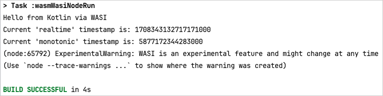

# Kotlin/Wasm WASI example

This example showcases a simple application using WASI API preview1 in [Wasmtime](https://wasmtime.dev/) and [WasmEdge](https://wasmedge.org/).

Follow the instructions in the sections below to try out this Kotlin/Wasm application.

## Set up the environment

Before starting, ensure you have the necessary IDE setup to run the application.

### IDE

We recommend using [IntelliJ IDEA 2023.1 or later](https://www.jetbrains.com/idea/) to work with the project.
It supports Kotlin/Wasm out of the box.

## Build and run

To build and run the application:

1. In IntelliJ IDEA, open the repository.
2. Run the application by typing one of the following Gradle commands in the terminal:

* **Run the program with WasmEdge:**

  `./gradlew wasmWasiWasmEdgeProductionRun`
   &nbsp; 

* **Run tests with WasmEdge:**

  `./gradlew wasmWasiWasmEdgeTest`
   &nbsp; 

* **Run the program with Wasmtime:**

  `./gradlew wasmWasiWasmtimeProductionRun`
   &nbsp; 

* **Run tests with Wasmtime:**

  `./gradlew wasmWasiWasmtimeTest`
   &nbsp; 

## Compiler Arguments

`build.gradle.kts` contains commented-out examples of Kotlin/Wasm compiler options for configuring
how exceptions are compiled. See the [full list of Kotlin/Wasm compiler options for 2.5.0](https://github.com/JetBrains/kotlin/blob/v2.5.0-Beta2/compiler/testData/cli/wasm/wasmExtraHelp.out).

## Feedback and questions

Give it a try and share your feedback or questions in our [#webassembly](https://slack-chats.kotlinlang.org/c/webassembly) 
Slack channel. [Get a Slack invite](https://surveys.jetbrains.com/s3/kotlin-slack-sign-up).
You can also share your comments with [@bashorov](https://twitter.com/bashorov) on X (Twitter).

## Learn more

* [Kotlin/Wasm](https://kotl.in/wasm/)
* [Other Kotlin/Wasm examples](https://github.com/Kotlin/kotlin-wasm-examples/tree/main)
